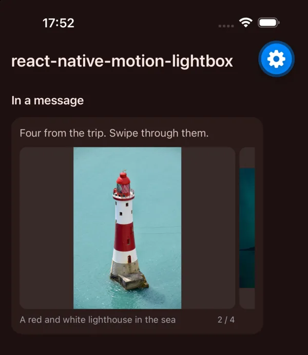
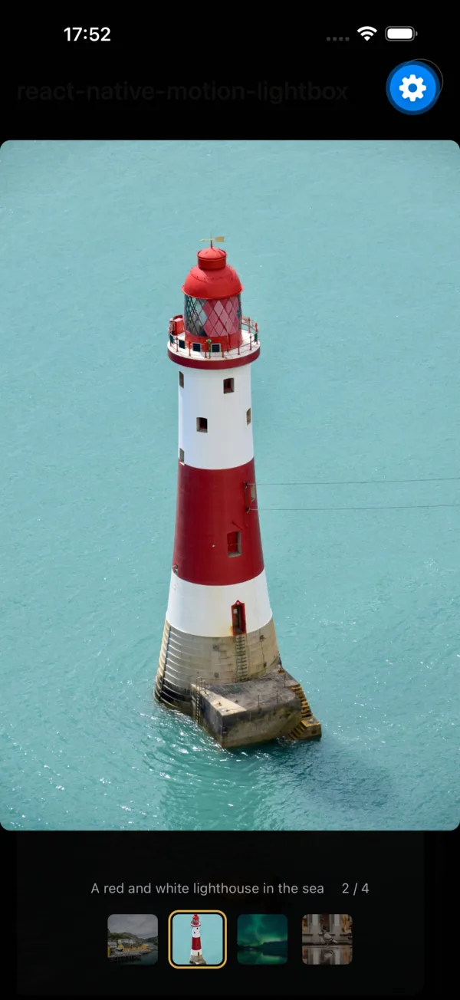

# react-native-motion-lightbox

A lightbox for React Native. It opens out of the picture you tapped and closes back into it.

It's the phone version of [react-motion-lightbox](https://github.com/sivert-io/react-motion-lightbox), which I built for my own site and for [Gryt](https://gryt.chat). Gryt's phone app is the first one to use this. The props have the same names wherever that made sense, so if you know one you know the other.

 

## What it does

- Opens out of the picture you tapped, measured on screen. Without one, it fades in.
- Swipe between pictures. You can flick them, and grab one while it's still moving.
- Pinch to zoom, up to 8x, and pan around while zoomed in. Double-tap zooms in on that spot, or back out.
- Swipe down to close. The picture shrinks a little and the background fades as you drag.
- Android's back button closes it, and so does VoiceOver's escape gesture.
- A tap hides the bars, so you can look at the picture alone.
- With reduced motion turned on, nothing slides. It switches straight away, and a gallery's autoplay stays still.

There's also `Gallery`, a small one for a chat message or a feed. It shows one picture at a time in a box, and a tap opens the lightbox out of it.

## Install

```sh
npm install react-native-motion-lightbox
```

You also need `react-native-reanimated` 4.5 or newer, `react-native-gesture-handler` 2.32 or newer, and `react-native-worklets`. In an Expo app, install them with `npx expo install` so you get versions that match your SDK. It doesn't use any Expo modules, so it works in a bare app too.

Your app needs a `GestureHandlerRootView` at the top, as Gesture Handler always does.

## Gallery

```tsx
import { Gallery } from 'react-native-motion-lightbox'

<Gallery
  items={[
    { kind: 'image', src: 'https://example.com/fjord.jpg', width: 5200, height: 3464, alt: 'A fjord' },
    { kind: 'image', src: 'https://example.com/harbour.jpg', width: 6000, height: 4000, alt: 'The harbour' },
  ]}
  aspect={4 / 3}
  fit="contain"
  peek={28}
  gap={6}
  caption={(item) => item.alt}
  onLongPress={(i) => openMessageMenu(i)}
/>
```

Swipe it, and tap a picture to open the lightbox. A swipe never counts as a tap. A swipe that goes mostly up or down is left to the screen, so a list around the gallery still scrolls.

It takes the same props as the lightbox and passes them on. On top of those:

| Prop | |
|---|---|
| `aspect` | A picture's width over its height. Default `1`, a square. |
| `fit` | `'cover'` (the default) fills the box with the part of each picture that `focus` and `zoom` pick. `'contain'` shows the whole picture inside the box. |
| `peek` | How many points of the next picture show at the right edge, so it reads as something to swipe. Default `0`. |
| `gap` | The space between pictures, in points. Default `12`. |
| `onPress(index)` | Called on a tap instead of opening the lightbox, if your app has a viewer of its own. |
| `onLongPress(index)` | Called on a long press, for a menu. |
| `autoplay` | Move on by itself every this many milliseconds, like `6000`. Off by default. It holds while a finger is on it or the lightbox is open, and adds a pause button. |
| `style` | Goes on the gallery's outer view. Give it a width, or let it fill its parent. |

Each picture can have a `focus` and a `zoom`. `focus` is the point the box centres on, as fractions across and down, and `zoom` is how far it zooms in on it. With `fit="cover"`, the lightbox opens out of exactly that part and then shows the whole picture.

## Lightbox on its own

For a grid or a list of your own, measure the thumbnail when it opens and closes, and pass that as `origin`:

```tsx
const cells = useRef<(View | null)[]>([])
const origin = (i: number) =>
  new Promise<Rect | undefined>((resolve) => {
    const cell = cells.current[i]
    if (!cell) return resolve(undefined)
    cell.measureInWindow((x, y, width, height) => resolve({ x, y, width, height }))
  })

<Lightbox
  items={items}
  index={index}
  open={open}
  onClose={() => setOpen(false)}
  onIndexChange={setIndex}
  origin={origin}
  caption={(item) => item.alt}
/>
```

## Props

| Prop | |
|---|---|
| `items` | `{ kind: 'image' \| 'video', src, alt?, width?, height?, poster?, thumb?, focus?, zoom? }[]`. If you leave out `width` and `height`, an image is measured once it loads. |
| `index`, `open` | Which item to show, and whether the lightbox is open. Change `index` while it's open and it moves there. |
| `onClose` | Someone pressed close, swiped down or pressed back. Set `open` to `false` and it animates out. |
| `onIndexChange(index)` | The item on screen changed. |
| `onExited(index)` | The close animation is done and the lightbox is gone. |
| `origin(index)` | Where an item opens out of and closes back into: a rect in window coordinates, or a promise of one. Return nothing and it fades instead. |
| `originCrop(index)` | If the thumbnail only shows part of the picture: `[left, top, width, height]` as fractions of it. |
| `renderVideo(item, { active })` | Draw a video with your own player. It fills the item's box, and `active` is true for the one on screen. Without it, a video shows its `poster`. |
| `title(item, index)` | Top left. A string goes in a `Text` for you. |
| `toolbar(item, index)` | Top right, before the close button. |
| `caption(item, index)` | Under the picture, before the "3 / 12" count. |
| `thumbnails` | The row of thumbnails when there's more than one item. Default `true`. |
| `maxZoom` | Default `8`. |
| `radius` | Corner radius in points. It stays the same all the way through the opening move. Default `12`. |
| `labels` | `{ dialog, close, previous, next, pause, play }`, for screen readers and other languages. |
| `icons` | `{ close, pause, play }`, any React node. |
| `colors` | `{ backdrop, color, muted, frame, slide }`. `frame` is the border round the current thumbnail, and `slide` sits behind each picture in a gallery. |
| `insets` | `{ top, bottom }`: room for the status bar and the home indicator. Pass your safe area insets. Without them it guesses. |

`cropOf(item, aspect)` gives you the same crop a gallery uses, and `useTrack` is the track both move on, if you build something of your own.

## Try it

The `example` folder is an Expo app with a chat message, an album with autoplay, and a grid that opens the lightbox on its own.

```sh
cd example && npm install && npx expo start
```

## What I haven't tested

I've run it on an iPhone 17 Pro Max simulator and an Android 16 emulator, with Expo 57, React Native 0.86, Reanimated 4.5 and Gesture Handler 2.32. I haven't tried it on a real phone yet, so pinching with real fingers is untested. I also haven't tried it in a bare React Native app, or with a video player passed to `renderVideo`. Landscape should work, but I've only looked at it upright.

## License

MIT. The logo is Brown Mushroom from Microsoft's [Fluent Emoji](https://github.com/microsoft/fluentui-emoji), also MIT ([its licence](docs/fluent-emoji-LICENSE)).
